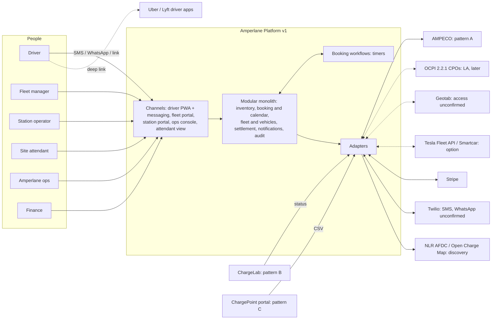

# High-level design, v0 (hypothesis)

> **v0 hypothesis** (playbook §10.1). This sketch is built from the context and the confirmed integration capabilities.
> It will be revised after Step 3. **Requirements must not cite this file**; they cite sources and `CTX-` facts.
> Decisions the sources show as already agreed are recorded as ADRs in [adr/](adr/). Everything else here is a
> proposal, and each component says how solid it is:
>
> - **agreed**: an ADR exists.
> - **client-stated**: the need comes from the client.
> - **proposed**: Intellias' proposal, not confirmed by the client.

## 1. Context

Dotted lines are options, later phases or unconfirmed access. There is no data integration with Uber or Lyft (CF-005).

## 2. Components

### 2.1 Channels

| Component | Responsibility | Why it exists | Solidity |
|---|---|---|---|
| Driver PWA + messaging | Book, confirm, cancel or report "running late" in one tap, receive reminders and re-offers, navigate. SMS/WhatsApp links open the PWA without an account (A-006). EN/ES/BN. | CTX-027, CTX-028, CTX-096, CTX-097, CTX-135 | agreed (ADR-009) |
| Fleet portal | Vehicles and drivers, policies (adapters, no-show payer, spend controls if any), bookings for others, invoices, reports. Small fleets may never log in; ops acts for them. | CTX-004, CTX-029, CTX-030, CTX-031, CTX-032 | client-stated |
| Station portal | Capacity rules per site and time window (self-service), upcoming bookings, faults and the bookings they cost, payouts (if options B/C). | CTX-004, CTX-037, CTX-065 | client-stated |
| Ops console | Manual holds, booking on behalf of drivers, overrides, bulk "rebook everyone" approval, no-show disputes with evidence, a queue of exceptions (failed holds, full sites). | CTX-035, CTX-036, CTX-066 | client-stated |
| Attendant view | Mobile web for site staff: who is due at which stall, place a sign, mark EVSE free, occupied or faulted, confirm "driver arrived". | CTX-033, CTX-034, CTX-062 | proposed; the need is client-stated, but nobody has confirmed the attendant would use it (U-13) |

### 2.2 Edge

| Component | Responsibility | Why it exists | Solidity |
|---|---|---|---|
| API gateway | Routing, rate limiting, checking idempotency keys. | CTX-093, CTX-115 | proposed |
| Identity & access (Keycloak) | SSO and roles for the four web front-ends; link-based driver sessions (A-006). | CTX-107 (access control for SOC 2) | proposed; driver identity is open (Q-028) |

### 2.3 Core: a TypeScript modular monolith (ADR-001, ADR-002)

| Module | Responsibility | Why it exists | Solidity |
|---|---|---|---|
| Inventory & availability | Sites, EVSEs, connectors (type, kW), a reservable flag per EVSE, capacity rules, live EVSE status with its observation time and source, the discovery layer. | CTX-058, CTX-060 – CTX-065, CTX-090, CTX-100, CTX-112 | client-stated |
| Booking & calendar | Slot calendar, holds, bookings against a pool, allocation to an EVSE, the lifecycle state machine, reason codes, re-offers, a per-site queue at burst time. | CTX-088, CTX-092, CTX-093, CTX-036, CTX-131 – CTX-133 | agreed (ADR-004, ADR-005, ADR-006) |
| Booking workflows (Temporal) | Durable timers and sagas per booking: hold TTL, reminder, T-15 station hold, T-10 check, grace and auto-release, rebooking after a fault. | CTX-094 | engine agreed (ADR-007); timings are assumptions A-001 – A-003; hosting open (Q-026) |
| Fleet & vehicles | Fleets, drivers, vehicles (native connector, adapters, max DC kW), fleet policies, booker vs charging driver, SoC (telematics or manual). | CTX-029, CTX-099 – CTX-101, CTX-134 | client-stated |
| Pricing & tariffs | Station B2B tariffs, the fleet rate and fees. The shape depends on the business model. | CTX-116, CTX-121 | **blocked by Q-001** |
| Settlement & payouts | Match bookings to session records, double-entry ledger, fee lines separate from energy, monthly net-30 fleet invoices, weekly payouts (if B/C), disputes, the cash-gap view. | CTX-095, CTX-126, CTX-127, CTX-129, CTX-032, CTX-068 | ledger agreed (ADR-008); flows **blocked by Q-001** |
| Notifications | SMS and WhatsApp templates in EN/ES/BN, dedupe of inbound messages by message ID, delivery status. | CTX-097, CTX-044, CTX-093 | client-stated |
| Audit | Append-only events: actor, action, reason, time, for every state change, override, manual action and payout. | CTX-036, CTX-107, CTX-110 | client-stated |
| Reporting | North-star metric (completed bookings), no-shows and utilisation for fleets, lost bookings per fault for stations. | CTX-037, CTX-138, SRC-D1#11 ("reporting") | client-stated; the metric definition is a client decision (Q-017); until then the Completed state in data-model.md |
| Pilot migration (one-off) | Map, clean and load the pilot history, keeping provenance. | CTX-053, CTX-054 | agreed (ADR-010); scope per working assumption A-026 (Q-020) |

### 2.4 Integration adapters (ADR-003)

| Adapter | Responsibility | Why it exists | Solidity |
|---|---|---|---|
| CSMS adapters: AMPECO, ChargeLab, CSV ingest | Normalise status events; send charger reservations where supported; fetch session records where available; ingest the LIC CSV for reconciliation. | CTX-060 – CTX-063, CTX-086, CTX-091 | client-stated; session records unconfirmed (U-6, U-7) |
| OCPI 2.2.1 eMSP gateway | Locations, Tariffs, Sessions, CDRs, Tokens, Commands (RESERVE_NOW). | CTX-071, CTX-104 | proposed (A-015) |
| Telematics adapters | Geotab now; Tesla Fleet API or Smartcar as options; manual SoC as a non-adapter fallback. | CTX-099, CTX-101 | Geotab access unconfirmed (Q-014) |
| Payments adapter (Stripe) | Invoices today; Connect transfers and 1099s if B/C. | CTX-051, CTX-128, A-007 | contingent on Q-001 |
| Messaging adapter (Twilio) | SMS today; WhatsApp to set up. | CTX-097, A-008 | WhatsApp unconfirmed (Q-034) |
| Discovery data (NLR AFDC, Open Charge Map) | A static map layer of non-partner chargers; never used for availability. | CTX-089 | proposed |
| Routing | Directions and arrival ETA. | SRC-D1#9 | provisional: Google Maps behind an adapter (CF-020, A-030) |

### 2.5 Data and platform

| Element | Role | Why | Solidity |
|---|---|---|---|
| PostgreSQL (+ PostGIS) | System of record; exclusion constraints; geo queries. | CTX-085, CTX-093 | Postgres agreed (ADR-001); PostGIS proposed |
| Time-series partitions | EVSE status history and metering. | CTX-112, CTX-127 (dispute evidence) | proposed |
| Valkey cache | Rate limits and idempotency keys only; holds stay in Postgres. | No CTX requires it: idempotency keys could live in Postgres (A-005, CF-017) | proposed; candidate to drop for v0 |
| Event bus (EventBridge/SQS) | Decouples adapters from the core. | Not required by CTX-091 (idempotent consumers and polling work without it); weigh against two engineers (CTX-007) | proposed; candidate to drop for v0 |
| AWS (ECS Fargate, RDS), Terraform, separate production account | Hosting in Amperlane's accounts. | CTX-005, CTX-085, CTX-107 | AWS and Terraform agreed (ADR-001); services proposed |
| OpenTelemetry + Grafana | Observability, SOC 2 evidence. | CTX-107 | proposed |
| EVerest simulator | A simulated site for tests: faults, overstays, late drivers, the Gowanus replay. | CTX-103 | client-stated |

## 3. One booking engine, three supply patterns

Only the station-hold step and the confidence of the guarantee differ (SRC-D2#8).

| Step | Pattern A: Gowanus (AMPECO) | Pattern B: JFK (ChargeLab) | Pattern C: LIC (no API) |
|---|---|---|---|
| Live status | Webhook plus periodic poll (CTX-091) | ChargeLab status API; push or poll unknown (Q-012) | Attendant view (U-13); CSV for reconciliation only (CTX-062) |
| Station hold at T-15 | ReserveNow on the 10 reservable EVSEs; soft hold plus signage on the other 6 (A-002) | Soft hold plus a signage request to site staff; ops fallback | Attendant notified to place a sign; ops fallback |
| Overstay or failed hold | Reassign to a compatible free EVSE at T-10, else ops (CTX-137) | Same, using live status | Attendant reports; ops |
| Arrival signal | CSMS session start (unconfirmed, U-14), QR at stall, or geofence with consent (CTX-102) | Session start (unconfirmed, U-14), QR, geofence | Attendant "driver arrived" (U-13), QR |
| Session record for settlement | AMPECO session record (U-6) | ChargeLab session record (U-6) | CSV row (U-7) |

## 4. Main runtime flows

**F1 · Book.** The driver taps a link (or texts), a fleet manager books for a vehicle, or ops books on behalf.
1. The request carries an idempotency key; a retried SMS is deduplicated by message ID (ADR-006).
2. At burst time, requests for a site go through a per-site queue in order (ADR-006).
3. A capacity check against the site's pool for the window considers capacity rules, connector or adapter
   compatibility and power (A-014).
4. A hold with TTL is created; on confirmation it becomes a booking. If the slot is gone, the driver gets an instant
   alternative.
5. A confirmation goes out in the driver's language.

**F2 · Before arrival.** A reminder goes out (A-011). At T-15 the booking is allocated to one EVSE (exclusion
constraint) and the station hold is executed per pattern (§3). If the hold fails, or at T-10 the EVSE is still in a
session, the booking is reassigned to a compatible free EVSE; if none is free, ops is alerted and the driver gets a
later slot at the same site or alternatives at other sites, with no no-show fee, and the booking is marked "moved — site
full" (A-019). Walk-ups are never bumped.

**F3 · Arrival, charging, completion.** The arrival signal moves the booking to Arrived, then the session status gives
Charging. When the session record is matched, the booking is Completed.

**F4 · No-show and late arrival.** If there is no arrival within grace (A-003), the slot is released automatically, the
booking becomes a no-show with a reason code, and a no-show fee line is created according to the payer policy (Q-002).
The driver gets an instant offer of what is free now; whether the fee then applies is open (Q-003). The CTO wants grace
stretched when the car is close (CTX-101), but stations expect release after ten minutes. Until this is settled
(CF-021), extending grace is an ops override only, up to a maximum set per site (A-020).

**F5 · Charger fault.** A Faulted status comes from a webhook, a poll or the attendant. The faulted EVSE leaves the pool
for the expected outage, so pool capacity drops for every affected slot. Every booking in the remaining window is
re-checked, whether or not it is already allocated (with late allocation most are not; in the Gowanus case nine bookings
ran from 2:15 to 7 PM, SRC-C2@00:51:58). Bookings that still fit stay; the rest are reassigned to a compatible EVSE at
the same site (whether a move may use walk-up capacity beyond the bookable cap is open, Q-038). Bookings that cannot be
placed go to ops with alternatives. Drivers are notified in their language, and the station sees the bookings lost. The
reason code is "moved — charger fault", not no-show (CTX-036, CTX-136). Same-site reassignment is automatic; ops
bulk-approves proposals for the bookings that cannot be placed and can undo a move (A-017; CF-022 is
resolved-provisional, for Dana Whitfield to confirm). A maintenance hold takes the same path (A-018). Test case: replay
the Gowanus fault (CTX-103).

**F6 · Status ingestion.** Adapters normalise events: duplicate and out-of-order events are tolerated, every status
records when and how it was observed, and a poll reconciles lost webhooks (CTX-091). The UI shows the age of status;
status for connected sites must be no older than 60 seconds (CTX-112).

**F7 · Settlement (contingent on Q-001).** Each booking is matched to a session record. The ledger records energy and
fee lines separately. Fleets receive a monthly net-30 invoice and stations are paid weekly (if B/C), and the cash gap
is visible per fleet (CTX-126, CTX-127).

**F8 · Dispute.** A fleet disputes a no-show. Ops sees the evidence (booking, hold sent, station status at the time,
location or QR scan, session record) and reverses the fee line or keeps it, without touching energy (CTX-127).

**F9 · Pilot migration (one-off).** The Airtable, Sheets and other exports are mapped to the new model. Status values
are normalised across the two historical changes, and moved bookings are re-classified where evidence allows.
Original values and source system are kept (CTX-053, CTX-054, Q-020).

## 5. Key constraints

| Constraint | Effect on design | Source |
|---|---|---|
| NYC production launch on 1 March 2027 | Scope is the lever; NYC only | CTX-079, CTX-082 |
| Budget of $0.9–1.2M through Q2 2027 | Small team; buy commodity rails | CTX-080 |
| Two Amperlane engineers will run it | Modular monolith, managed services | CTX-007, CTX-087 |
| IP owned by Amperlane; no vendor SDK in the core | Adapters at the edge; Terraform in Amperlane's accounts | CTX-005, CTX-086 |
| Chargers cannot hold future slots | Amperlane owns the calendar | CTX-088 |
| Three supply patterns in NYC | Pattern-specific station hold; ops and attendant fallback | CTX-063 |
| Walk-ups never bumped; caps of 30–50% at peak | Pool booking, late allocation, capacity rules per window | CTX-064, CTX-066 |
| Contention burst at shift change | Database-enforced exclusion, per-site queue, idempotency | CTX-115, CTX-093 |
| p95 < 300 ms; 99.9% from 5 AM to 1 AM ET; status ≤ 60 s | Latency budget includes the constraint check; overnight bookings allowed; during 1–5 AM maintenance, timers may fire late but are never lost (A-028) | CTX-112 – CTX-114, CF-015 |
| SOC 2-ready, SHIELD, location consent | Audit log, access control, encryption, retention per data type | CTX-107 – CTX-110 |
| Business model undecided | Generic ledger now; pricing and settlement flows wait | CTX-123, CTX-129 |

## 6. Design risks and open points

1. **Pool capacity versus allocatable EVSEs (A-014).** Counting per connector type ignores adapters (one vehicle can
   use either pool), power matching, bookings that span two to four 15-minute slots, and the 10-minute buffer. Accepting
   a booking needs a feasibility check against the EVSEs that can actually be allocated, not just a counter. Prototype
   in Phase 0 with the simulator.
2. **The guarantee at patterns B and C is soft.** A confirmed booking is a promise that a walk-up or an overstay can
   break. The capacity caps leave slack (CTX-064), but the failure path ("site full, ops pinged") needs a defined driver
   outcome (working assumption A-019, Q-033) and ops coverage (Q-023).
3. **Holds storage** is Postgres per A-005; confirm with the prototype (CF-017). The CTO's "no double booking"
   agreement covered an exclusion constraint over held and confirmed bookings (SRC-C2@00:31:51). Under late allocation
   those bookings have no EVSE, so before T-15 only the capacity check (A-014) protects capacity (CF-023).
4. **Driver identity without accounts** (A-006, Q-028) must still meet SOC 2 access control (CTX-107).
5. **Overnight slots versus the maintenance window** (CF-015, Q-024). Working assumption A-028: overnight bookings are
   allowed, and during maintenance timers may fire late but are never lost. A late auto-release keeps a stall coned, and
   night exceptions need ops cover (Q-023).
6. **Settlement depends on session records** that are unconfirmed at all three sites (U-6, U-7). Without them, even
   the $2 booking fee cannot be checked against actual sessions.
7. **Time zones:** NYC only at launch, but per-site time zones from the start (A-013).
8. **OCPI 2.3 Booking alignment:** the slot and booking entities should map onto OCPI 2.3 Booking later
   (SRC-C2@00:13:32).

## 7. Revision trigger

Revise this file to v1 after Gate 3 (stories and system stories). Also revise it, for the affected parts, when any of
these close: Q-001, Q-010, Q-014, Q-015, Q-017, Q-026, Q-038, CF-015, CF-020, CF-025.
