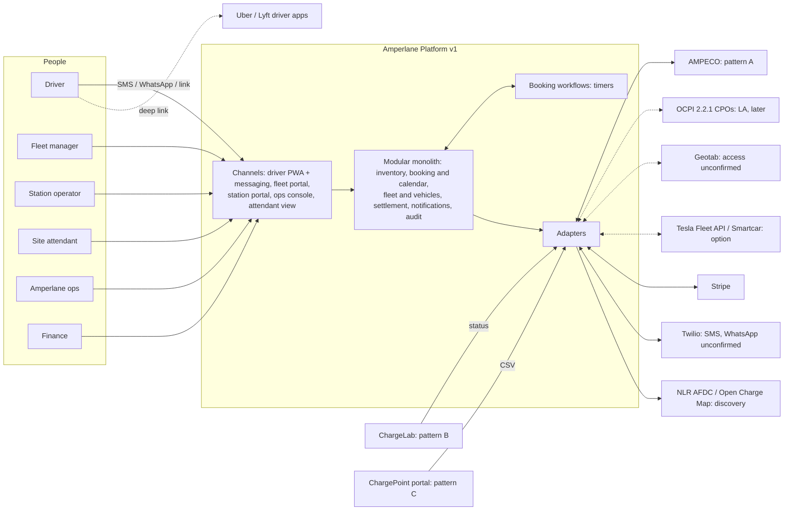

# High-level design, v3

> **v1** (Gate 3, 2026-10-28). v0 was a hypothesis (playbook §10.1), built from the context and the confirmed
> integration capabilities. v1 adds what Step 3 settled: the refined component names the system stories use (§2.6) and
> the configured parameters with their defaults (§8, A-059). The rest of the v0 text stands until a trigger of §7.
> **v2** (Gate 4, 2026-10-28) adds the configured parameters the Step 4 task critique found missing (§8: the site-staff
> request channel and number, arrival from a session start and its evidence, the cut-over takeover reply timeout) and
> the open technical decisions for Phase 0 (§9).
> **v3** (CR-012, 2026-10-29) aligns §2.4 and §2.5 with the KYIV of Gate 2 and the Step 4 tasks: the OCPI gateway,
> telematics and routing are not in the committed plan, and the cache and the event bus are dropped. The data model and
> the integrations inventory were revised with it (data-model.md v1, integrations.md v1).
> **Requirements must not cite this file**; they cite sources and `CTX-` facts.
> Decisions the sources show as already agreed are recorded as ADRs in [adr/](adr/). Everything else here is a
> proposal, and each component says how solid it is:
>
> - **agreed**: an ADR exists.
> - **client-stated**: the need comes from the client.
> - **proposed**: Intellias' proposal, not confirmed by the client.

## 1. Context

Dotted lines are options, later phases or unconfirmed access. There is no data integration with Uber or Lyft (CF-005).

## 2. Components

Each system story names its component in `component:`. Five names refine the v0 components below (§2.6); the old names
stay in §2.1 – §2.5 for the parts they still describe.

### 2.1 Channels

| Component | Responsibility | Why it exists | Solidity |
|---|---|---|---|
| Driver PWA + messaging | Book, confirm, cancel or report "running late" in one tap, receive reminders and re-offers, navigate. SMS/WhatsApp links open the PWA without an account (A-006). EN/ES/BN. | CTX-027, CTX-028, CTX-096, CTX-097, CTX-135 | agreed (ADR-009) |
| Fleet portal | Vehicles and drivers, policies (adapters, no-show payer, spend controls if any), bookings for others, invoices, reports. Small fleets may never log in; ops acts for them. | CTX-004, CTX-029, CTX-030, CTX-031, CTX-032 | client-stated |
| Station portal | Capacity rules per site and time window (self-service), upcoming bookings, faults and the bookings they cost, payouts (if options B/C). | CTX-004, CTX-037, CTX-065 | client-stated |
| Ops console | Manual holds, booking on behalf of drivers, overrides, bulk "rebook everyone" approval, no-show disputes with evidence, a queue of exceptions (failed holds, full sites). | CTX-035, CTX-036, CTX-066 | client-stated |
| Attendant view | Mobile web for site staff: who is due at which stall, place a sign, mark EVSE free, occupied or faulted, confirm "driver arrived". | CTX-033, CTX-034, CTX-062 | proposed; the need is client-stated, but nobody has confirmed the attendant would use it (U-13) |

### 2.2 Edge

| Component | Responsibility | Why it exists | Solidity |
|---|---|---|---|
| API gateway | Routing, rate limiting, checking idempotency keys. | CTX-093, CTX-115 | proposed |
| Identity & access (Keycloak) | SSO and roles for the four web front-ends; link-based driver sessions (A-006). | CTX-107 (access control for SOC 2) | proposed; driver identity is open (Q-028) |

### 2.3 Core: a TypeScript modular monolith (ADR-001, ADR-002)

| Module | Responsibility | Why it exists | Solidity |
|---|---|---|---|
| Inventory & availability | Sites, EVSEs, connectors (type, kW), a reservable flag per EVSE, capacity rules, live EVSE status with its observation time and source, the discovery layer. | CTX-058, CTX-060 – CTX-065, CTX-090, CTX-100, CTX-112 | client-stated |
| Booking & calendar | Slot calendar, holds, bookings against a pool, allocation to an EVSE, the lifecycle state machine, reason codes, re-offers, a per-site queue at burst time. | CTX-088, CTX-092, CTX-093, CTX-036, CTX-131 – CTX-133 | agreed (ADR-004, ADR-005, ADR-006) |
| Booking workflows (Temporal) | Durable timers and sagas per booking: hold TTL, reminder, T-15 station hold, T-10 check, grace and auto-release, rebooking after a fault. | CTX-094 | engine agreed (ADR-007); timings are assumptions A-001 – A-003; hosting open (Q-026) |
| Fleet & vehicles | Fleets, drivers, vehicles (native connector, adapters, max DC kW), fleet policies, booker vs charging driver, SoC (telematics or manual). | CTX-029, CTX-099 – CTX-101, CTX-134 | client-stated |
| Pricing & tariffs | Station B2B tariffs, the fleet rate and fees. The shape depends on the business model. | CTX-116, CTX-121 | **blocked by Q-001** |
| Settlement & payouts | Match bookings to session records, double-entry ledger, fee lines separate from energy, monthly net-30 fleet invoices, weekly payouts (if B/C), disputes, the cash-gap view. | CTX-095, CTX-126, CTX-127, CTX-129, CTX-032, CTX-068 | ledger agreed (ADR-008); flows **blocked by Q-001** |
| Notifications | SMS and WhatsApp templates in EN/ES/BN, dedupe of inbound messages by message ID, delivery status. | CTX-097, CTX-044, CTX-093 | client-stated |
| Audit | Append-only events: actor, action, reason, time, for every state change, override, manual action and payout. | CTX-036, CTX-107, CTX-110 | client-stated |
| Reporting | North-star metric (completed bookings), no-shows and utilisation for fleets, lost bookings per fault for stations. | CTX-037, CTX-138, SRC-D1#11 ("reporting") | client-stated; the metric definition is a client decision (Q-017); until then the Completed state in data-model.md |
| Pilot migration (one-off) | Map, clean and load the pilot history, keeping provenance. | CTX-053, CTX-054 | agreed (ADR-010); scope per working assumption A-026 (Q-020) |

### 2.4 Integration adapters (ADR-003)

| Adapter | Responsibility | Why it exists | Solidity |
|---|---|---|---|
| CSMS adapters: AMPECO, ChargeLab, CSV ingest | Normalise status events; send charger reservations where supported; fetch session records where available; ingest the LIC CSV for reconciliation. | CTX-060 – CTX-063, CTX-086, CTX-091 | client-stated; session records unconfirmed (U-6, U-7) |
| OCPI 2.2.1 eMSP gateway | Locations, Tariffs, Sessions, CDRs, Tokens, Commands (RESERVE_NOW). | CTX-071, CTX-104 | proposed (A-015); I at Gate 2 (REQ-166), not in the committed plan |
| Telematics adapters | Geotab, Tesla Fleet API or Smartcar; manual SoC (REQ-018) and booking without vehicle data (REQ-019) cover the gap. | CTX-099, CTX-101 | not in the committed plan: Geotab is I (REQ-075), Tesla Fleet API and Smartcar are V (REQ-311, REQ-312); Geotab access unconfirmed (Q-014) |
| Payments adapter (Stripe) | Fleet invoices in every business-model option; Connect transfers and 1099s only if B/C. | CTX-051, CTX-128, A-007 | invoices client-stated (REQ-083, REQ-087); Connect contingent on Q-001 |
| Messaging adapter (Twilio) | SMS; WhatsApp behind a switch that is off (§8). | CTX-097, A-008 | WhatsApp is Y (REQ-062) and unconfirmed (Q-034) |
| Discovery data (NLR AFDC, Open Charge Map) | A static map layer of non-partner chargers; never used for availability. | CTX-089 | proposed |
| Routing | Directions and arrival ETA. | SRC-D1#9 | provisional: Google Maps behind an adapter (CF-020, A-030); not in the committed plan: directions open the driver's navigation app (REQ-064), ETA is I (REQ-065) |

### 2.5 Data and platform

| Element | Role | Why | Solidity |
|---|---|---|---|
| PostgreSQL (+ PostGIS) | System of record; exclusion constraints; geo queries. | CTX-085, CTX-093 | Postgres agreed (ADR-001); PostGIS proposed |
| Time-series partitions | EVSE status history and metering. | CTX-112, CTX-127 (dispute evidence) | proposed |
| Valkey cache | Rate limits and idempotency keys only; holds stay in Postgres. | No CTX requires it: idempotency keys could live in Postgres (A-005, CF-017) | dropped in Step 4: idempotency keys live in Postgres (SS-014, T-207) |
| Event bus (EventBridge/SQS) | Decouples adapters from the core. | Not required by CTX-091 (idempotent consumers and polling work without it); weigh against two engineers (CTX-007) | dropped in Step 4: a transactional outbox in Postgres (SS-427, T-1001) |
| AWS (ECS Fargate, RDS), Terraform, separate production account | Hosting in Amperlane's accounts. | CTX-005, CTX-085, CTX-107 | AWS and Terraform agreed (ADR-001); services proposed |
| OpenTelemetry + Grafana | Observability, SOC 2 evidence. | CTX-107 | proposed |
| EVerest simulator | A simulated site for tests: faults, overstays, late drivers, the Gowanus replay. | CTX-103 | client-stated |

### 2.6 Components refined in Step 3

Adopted at Gate 3 (2026-10-28). Booking & calendar keeps its calendar part (holds, confirmation, cancellation, offers,
the state machine and reason codes), and Inventory & availability its configuration part. None of these changes an ADR.

| Component | Responsibility | Formerly | Solidity |
|---|---|---|---|
| Allocation & rebooking | Late allocation and EVSE choice, the no-overlap guarantee, reallocation, site-full handling, fault and maintenance rebooking, proposals and undo. | Booking & calendar (allocation part), §2.3 | agreed (ADR-005, ADR-006); timings A-002 |
| Station-hold dispatcher | The station hold at the station-hold offset per supply pattern (charger reservation, site-staff request, ops manual list), with fallbacks, acknowledgements, clearing and the station-hold record; reaches chargers only through the CSMS integrations. | Booking & calendar (station-hold part), §2.3 and §3 | client-stated; reservations per Q-009 |
| Arrival & no-show | Arrival evidence (QR scan, CSMS session start, attendant), grace and auto-release, late arrival and running late, grace extension, the no-show fee decision, blocked-stall reports and disputes. | Booking & calendar (arrival part), §2.3 | client-stated; grace A-003, session starts A-051 |
| EVSE status service | Vendor-neutral EVSE status with its freshness and history, feed outage and silent-EVSE handling, attendant status, fault intake and return to service. | Inventory & availability (live-status part), §2.3 | client-stated |
| Partner portals | Fleet portal, station portal and attendant view with their read models; the editing behaviour belongs to the core components. | Fleet portal, Station portal and Attendant view, §2.1 | client-stated; attendant use unconfirmed (U-13) |

## 3. One booking engine, three supply patterns

Only the station-hold step and the confidence of the guarantee differ (SRC-D2#8).

| Step | Pattern A: Gowanus (AMPECO) | Pattern B: JFK (ChargeLab) | Pattern C: LIC (no API) |
|---|---|---|---|
| Live status | Webhook plus periodic poll (CTX-091) | ChargeLab status API; push or poll unknown (Q-012) | Attendant view (U-13); CSV for reconciliation only (CTX-062) |
| Station hold at T-15 | ReserveNow on the 10 reservable EVSEs; soft hold plus signage on the other 6 (A-002) | Soft hold plus a signage request to site staff; ops fallback | Attendant notified to place a sign; ops fallback |
| Overstay or failed hold | Reassign to a compatible free EVSE at T-10, else ops (CTX-137) | Same, using live status | Attendant reports; ops |
| Arrival signal | CSMS session start (unconfirmed, U-14), QR at stall, or geofence with consent (CTX-102) | Session start (unconfirmed, U-14), QR, geofence | Attendant "driver arrived" (U-13), QR |
| Session record for settlement | AMPECO session record (U-6) | ChargeLab session record (U-6) | CSV row (U-7) |

## 4. Main runtime flows

**F1 · Book.** The driver taps a link (or texts), a fleet manager books for a vehicle, or ops books on behalf.
1. The request carries an idempotency key; a retried SMS is deduplicated by message ID (ADR-006).
2. At burst time, requests for a site go through a per-site queue in order (ADR-006).
3. A capacity check against the site's pool for the window considers capacity rules, connector or adapter
   compatibility and power (A-014).
4. A hold with TTL is created; on confirmation it becomes a booking. If the slot is gone, the driver gets an instant
   alternative.
5. A confirmation goes out in the driver's language.

**F2 · Before arrival.** A reminder goes out (A-011). At T-15 the booking is allocated to one EVSE (exclusion
constraint) and the station hold is executed per pattern (§3). If the hold fails, or at T-10 the EVSE is still in a
session, the booking is reassigned to a compatible free EVSE; if none is free, ops is alerted and the driver gets a
later slot at the same site or alternatives at other sites, with no no-show fee, and the booking is marked "moved — site
full" (A-019). Walk-ups are never bumped.

**F3 · Arrival, charging, completion.** The arrival signal moves the booking to Arrived, then the session status gives
Charging. When the session record is matched, the booking is Completed.

**F4 · No-show and late arrival.** If there is no arrival within grace (A-003), the slot is released automatically, the
booking becomes a no-show with a reason code, and a no-show fee line is created according to the payer policy (Q-002).
The driver gets an instant offer of what is free now; whether the fee then applies is open (Q-003). The CTO wants grace
stretched when the car is close (CTX-101), but stations expect release after ten minutes. Until this is settled
(CF-021), extending grace is an ops override only, up to a maximum set per site (A-020).

**F5 · Charger fault.** A Faulted status comes from a webhook, a poll or the attendant. The faulted EVSE leaves the pool
for the expected outage, so pool capacity drops for every affected slot. Every booking in the remaining window is
re-checked, whether or not it is already allocated (with late allocation most are not; in the Gowanus case nine bookings
ran from 2:15 to 7 PM, SRC-C2@00:51:58). Bookings that still fit stay; the rest are reassigned to a compatible EVSE at
the same site (whether a move may use walk-up capacity beyond the bookable cap is open, Q-038). Bookings that cannot be
placed go to ops with alternatives. Drivers are notified in their language, and the station sees the bookings lost. The
reason code is "moved — charger fault", not no-show (CTX-036, CTX-136). Same-site reassignment is automatic; ops
bulk-approves proposals for the bookings that cannot be placed and can undo a move (A-017; CF-022 is
resolved-provisional, for Dana Whitfield to confirm). A maintenance hold takes the same path (A-018). Test case: replay
the Gowanus fault (CTX-103).

**F6 · Status ingestion.** Adapters normalise events: duplicate and out-of-order events are tolerated, every status
records when and how it was observed, and a poll reconciles lost webhooks (CTX-091). The UI shows the age of status;
status for connected sites must be no older than 60 seconds (CTX-112).

**F7 · Settlement (contingent on Q-001).** Each booking is matched to a session record. The ledger records energy and
fee lines separately. Fleets receive a monthly net-30 invoice and stations are paid weekly (if B/C), and the cash gap
is visible per fleet (CTX-126, CTX-127).

**F8 · Dispute.** A fleet disputes a no-show. Ops sees the evidence (booking, hold sent, station status at the time,
location or QR scan, session record) and reverses the fee line or keeps it, without touching energy (CTX-127).

**F9 · Pilot migration (one-off).** The Airtable, Sheets and other exports are mapped to the new model. Status values
are normalised across the two historical changes, and moved bookings are re-classified where evidence allows.
Original values and source system are kept (CTX-053, CTX-054, Q-020).

## 5. Key constraints

| Constraint | Effect on design | Source |
|---|---|---|
| NYC production launch on 1 March 2027 | Scope is the lever; NYC only | CTX-079, CTX-082 |
| Budget of $0.9–1.2M through Q2 2027 | Small team; buy commodity rails | CTX-080 |
| Two Amperlane engineers will run it | Modular monolith, managed services | CTX-007, CTX-087 |
| IP owned by Amperlane; no vendor SDK in the core | Adapters at the edge; Terraform in Amperlane's accounts | CTX-005, CTX-086 |
| Chargers cannot hold future slots | Amperlane owns the calendar | CTX-088 |
| Three supply patterns in NYC | Pattern-specific station hold; ops and attendant fallback | CTX-063 |
| Walk-ups never bumped; caps of 30–50% at peak | Pool booking, late allocation, capacity rules per window | CTX-064, CTX-066 |
| Contention burst at shift change | Database-enforced exclusion, per-site queue, idempotency | CTX-115, CTX-093 |
| p95 < 300 ms; 99.9% from 5 AM to 1 AM ET; status ≤ 60 s | Latency budget includes the constraint check; overnight bookings allowed; during 1–5 AM maintenance, timers may fire late but are never lost (A-028) | CTX-112 – CTX-114, CF-015 |
| SOC 2-ready, SHIELD, location consent | Audit log, access control, encryption, retention per data type | CTX-107 – CTX-110 |
| Business model undecided | Generic ledger now; pricing and settlement flows wait | CTX-123, CTX-129 |

## 6. Design risks and open points

1. **Pool capacity versus allocatable EVSEs (A-014).** Counting per connector type ignores adapters (one vehicle can
   use either pool), power matching, bookings that span two to four 15-minute slots, and the 10-minute buffer. Accepting
   a booking needs a feasibility check against the EVSEs that can actually be allocated, not just a counter. Prototype
   in Phase 0 with the simulator.
2. **The guarantee at patterns B and C is soft.** A confirmed booking is a promise that a walk-up or an overstay can
   break. The capacity caps leave slack (CTX-064), but the failure path ("site full, ops pinged") needs a defined driver
   outcome (working assumption A-019, Q-033) and ops coverage (Q-023).
3. **Holds storage** is Postgres per A-005; confirm with the prototype (CF-017). The CTO's "no double booking"
   agreement covered an exclusion constraint over held and confirmed bookings (SRC-C2@00:31:51). Under late allocation
   those bookings have no EVSE, so before T-15 only the capacity check (A-014) protects capacity (CF-023).
4. **Driver identity without accounts** (A-006, Q-028) must still meet SOC 2 access control (CTX-107).
5. **Overnight slots versus the maintenance window** (CF-015, Q-024). Working assumption A-028: overnight bookings are
   allowed, and during maintenance timers may fire late but are never lost. A late auto-release keeps a stall coned, and
   night exceptions need ops cover (Q-023).
6. **Settlement depends on session records** that are unconfirmed at all three sites (U-6, U-7). Without them, even
   the $2 booking fee cannot be checked against actual sessions.
7. **Time zones:** NYC only at launch, but per-site time zones from the start (A-013).
8. **OCPI 2.3 Booking alignment:** the slot and booking entities should map onto OCPI 2.3 Booking later
   (SRC-C2@00:13:32).

## 7. Revision trigger

v1 is the revision after Gate 3 (stories and system stories). Revise this file, for the affected parts, when any of
these close: Q-001, Q-010, Q-014, Q-015, Q-017, Q-026, Q-038, CF-015, CF-020, CF-025; revise §8 when a value of A-059
is changed in Phase 0 or a client decision in §8 is made.

## 8. Configured parameters

The requirements name "a set time", "a set period" or "a set interval" with no number; the system stories name each
value and SS-026 holds the catalogue (REQ-146). The defaults below are A-059 (Intellias proposal, Step 3.3,
2026-10-28, validated in Phase 0) unless the basis names a source or a registered item for that very parameter.
Client decisions have no default. Each value is changed without a deployment, and a booking keeps the version it was
confirmed under (SS-026 clauses 4, 5). Offsets are before the slot start unless stated. The owning SS holds the value;
its consumers follow in brackets.

| Parameter | Default | Unit | Owning SS (consumers) | Basis |
|---|---|---|---|---|
| **Per site (SS-026 clauses 1, 10, 11)** | | | | |
| Time grid | 15 | min | SS-026 (SS-001, SS-002) | A-001 (SRC-C2@00:27:21, SRC-D2#7) |
| Booking durations | 30, 45, 60 | min | SS-026 (SS-002) | A-001 |
| Buffer | 10 | min | SS-026 (SS-102) | A-001 |
| Hold time | 3 | min | SS-026 (SS-002) | A-001 |
| Allocation offset | 15 | min | SS-026 (SS-100) | A-002 (T-15) |
| Station-hold offset | 15, run after allocation | min | SS-026 (SS-104, SS-116, SS-118) | A-002 (T-15) |
| Pre-arrival check offset | 10 | min | SS-026 (SS-104, SS-105, SS-119) | A-002 (T-10) |
| Reminder lead time | 30 | min | SS-026 (SS-033) | A-059 (Intellias proposal; A-011 left the default open). Before allocation and station hold, so a cancel or "running late" frees the slot before an EVSE is tied up (JS-224). |
| Grace period | 10 | min | SS-026 (SS-127) | REQ-034, A-003 (SRC-C1@00:09:55) |
| Maximum grace extension (total per booking) | 5 | min | SS-026 (SS-130) | A-059 (Intellias proposal): within A-020's mechanism; a station term (CF-021, Q-004) |
| Arrival-window start | 15 | min | SS-026 (SS-124 – SS-126, SS-407) | A-059 (Intellias proposal): equal to the allocation offset (A-002): arrival is judged on the allocated EVSE |
| Reservation answer timeout | 60 | s | SS-026 (SS-117, SS-212) | A-059 (Intellias proposal) |
| Site-staff delivery timeout | 2 | min | SS-026 (SS-118, SS-120, SS-122) | A-059 (Intellias proposal) |
| Clear-instruction time | 2, after release, cancellation or rebooking | min | SS-026 (SS-120) | A-059 (Intellias proposal) |
| Cancellation cut-off | the slot start | instant | SS-026 (SS-013, SS-132) | A-049 (Q-042) |
| Silence time | 5 | min | SS-026 (SS-204) | A-059 (Intellias proposal): must exceed the 60 s stale threshold (N2) |
| Site-staff request channel | attendant view | setting (attendant view or SMS) | SS-026 clause 10 (SS-118) | A-059 (Intellias proposal, Gate 4): A-046 and A-048 let site staff acknowledge in the attendant view or by SMS reply; the attendant view needs no staff number. Validated with the station operators (Q-041, Q-059) |
| Arrival from a session start | off | setting | SS-026 clause 11 (SS-125) | A-051 (2): switched on per site only once Phase 0 confirms the session-start evidence there (Q-009, Q-012, Q-051) |
| Session-start evidence | the EVSE's status changing to charging or occupied | setting (CSMS session-start event or status change) | SS-026 clause 11 (SS-125, SS-107) | A-051 (1): the CSMS session-start event where Phase 0 confirms the CSMS sends one, otherwise the status change |
| **Platform-wide (SS-026 clause 2)** | | | | |
| Site-full exception time | 60 | s | SS-026 (SS-105) | A-059 (Intellias proposal) |
| Unplaced-booking exception time | 5, after the fault | min | SS-026 (SS-109) | A-059 (Intellias proposal) |
| Fault reaction time | 60, after the fault status is received | s | SS-026 (SS-208) | A-059 (Intellias proposal) |
| Late-arrival re-offer time | 60, after the late arrival is recorded | s | SS-026 (SS-128, SS-316) | A-059 (Intellias proposal) |
| Fault offer time | 3, after the fault is recorded | min | SS-026 (SS-109, SS-316) | A-059 (Intellias proposal) |
| Station-operator notice time | 15, after the fault is recorded or the hold saved | min | SS-026 (SS-313) | A-059 (Intellias proposal) |
| Session-start wait | 5, after the later of arrival and slot start (SS-107 clause 1) | min | SS-026 (SS-107) | A-059 (Intellias proposal) |
| Stable-available time | 30 | min | SS-026 (SS-209) | A-059 (Intellias proposal) |
| Timer lateness tolerance | 60, after the end of grace | s | SS-026 (SS-127) | A-059 (Intellias proposal) |
| Session match time | 15, after the record is stored | min | SS-026 (SS-407) | A-059 (Intellias proposal) |
| Session-record read interval | 5 | min | SS-026 (SS-213) | A-059 (Intellias proposal) |
| Invoice close offset | 3 days after month end; the close runs at 00:00 America/New_York on the 4th calendar day; period boundaries stay in each site's time zone (REQ-218, A-013) | days | SS-026 (SS-404, SS-410) | A-059 (Intellias proposal) |
| Delivery-status wait | 3 | min | SS-026 (SS-307) | A-059 (Intellias proposal) |
| Link validity after grace | 24, after grace ends | h | SS-026 (SS-320) | A-059 (Intellias proposal) |
| Link validity for a driver-page link requested by text | 24, from issue | h | SS-026 (SS-320) | A-059 (Intellias proposal) |
| One-time-code validity | 10 | min | SS-026 (SS-321) | A-059 (Intellias proposal) |
| Verified-device period | 30 | days | SS-026 (SS-321) | A-059 (Intellias proposal) |
| Wrong-code limit | 5 in a row per number | wrong codes | SS-026 (SS-321) | A-059 (Intellias proposal) |
| Code lockout time | 15 | min | SS-026 (SS-321) | A-059 (Intellias proposal) |
| Cancellation retry interval (charger reservations) | 60, until confirmed or the reservation expires | s | SS-026 (SS-212) | A-059 (Intellias proposal) |
| Payment retry interval | 15 | min | SS-026 (SS-412) | A-059 (Intellias proposal) |
| Payment check interval | 1 | h | SS-026 (SS-413) | A-059 (Intellias proposal) |
| Outage-copy refresh interval | 5 | min | SS-026 (SS-436) | A-059 (Intellias proposal) |
| Outage-copy horizon | 12, after the refresh | h | SS-026 (SS-436) | A-059 (Intellias proposal) |
| Number of cross-site alternatives | 3 | offers | SS-026 (SS-010) | A-059 (Intellias proposal) |
| Dispute window | 30, from the booking's slot start | days | SS-026 (SS-134) | A-047 |
| Default adapter policy for new fleets | adapters forbidden until the fleet sets its policy (REQ-072) | setting | SS-026 (SS-039) | A-059 (Intellias proposal): connector mismatches in the pilot (CTX-049) |
| **Per CSMS integration (SS-026 clause 9)** | | | | |
| Status poll interval | 20 | s | SS-026 (SS-201) | A-059 (Intellias proposal): must keep N1's 60 s (REQ-104, REQ-107) within the vendor's rate limit (Q-061) |
| **Held by their own SS** | | | | |
| Idempotency-key retention (platform keys, inbound message and event ids) | at least 7 | days | SS-014, SS-025, SS-309 | A-035 |
| Provider idempotency-key retention (Stripe) | 24 | h | SS-412 | A-059 (Intellias proposal): from Stripe's documentation, not a presale source (Q-062) |
| Cut-over instant | 2027-03-01 01:00 America/New_York | instant | SS-422 (SS-410, SS-421) | A-059 (Intellias proposal): the launch date of REQ-142 (SRC-C1@00:29:06) at the start of the N5 maintenance window (A-028), Step 3.1 bucket-5 #46; moves with CF-027 |
| Takeover reply timeout | 5 | min | SS-422 clauses 4, 5 | A-059 (Intellias proposal, Gate 4; NEW-Q-P3-3 of the P4.2 critique): the help keyword and the platform's reply each cross the carrier once, and the reply is due within the 10 s dispatch target (constitution N11, A-036), so 5 minutes leaves room for carrier delay without holding the cut-over in the maintenance window; checked at the cut-over rehearsal |
| Consecutive failed synthetic checks before the availability alert | 3 | checks (one a minute, A-033) | SS-428 | A-059 (Intellias proposal) |
| Prototype similarity threshold | a duplicated block of 10 or more lines | lines | SS-439 | A-059 (Intellias proposal) |
| Staging test number range | +1 NPA-555-0100 to NPA-555-0199 | phone numbers | SS-339 (SS-435) | A-059 (Intellias proposal): NANP numbers reserved for fictional use, not a presale source |
| Completed definition | the Completed state (data-model §3) | definition | SS-229 | Q-017's interim rule (A-027 withdrawn) |
| Replies to unregistered numbers | off | setting | SS-312 (SS-310) | Q-056 with Step 3.1 bucket-5 #28 (no reply until the agreement rule is known) |
| WhatsApp channel enabled | off, until the Twilio WhatsApp sender and the EN/ES/BN templates are approved | setting | SS-308 | constitution R7 fallback for U-10 (Q-034) |
| Site time zone | America/New_York for the NYC sites | zone | SS-021 | A-013 |
| **Client decisions: no default** | | | | |
| No-show fee amount and station share | client decision | USD | SS-027 | Q-002, Q-005 (bucket-5 #17); recorded per site before it goes live; an explicit zero is allowed |
| Bookable hours and capacity rules | client decision | — | SS-023 | Q-005; set per site at onboarding |
| Site-staff number for SMS requests | client decision | phone number (E.164) | SS-026 clause 10 (SS-118) | Q-041 (JFK), Q-059 (Gowanus): the station operator names it; none until set, and until then the site cannot be switched to SMS (SS-026 clause 12) |
| Agreement forms | client decision | list | SS-304 | Q-056 (legal policy); none until Q-056 is answered |
| Pre-launch real-booking period | client decision | dates | SS-423 | Q-055 (go-live criteria); none until Q-055 is answered |
| Raw pilot export retention period | client decision | period | SS-420 | Q-022, A-025; none until counsel sets it, shown as "not set" (SS-420 clause 5) |

64 parameters: 17 with a source or a registered item, 41 under A-059, 6 client decisions. v1 had 59 (15, 39 and
5); v2 adds the site-staff request channel and the takeover reply timeout (A-059), arrival from a session start and
its evidence (A-051), and the site-staff number (client decision).

Not configuration: webhook secrets (SS-218, SS-317) are credentials; the 60 s stale threshold and status-age bound
(constitution N1, N2; REQ-104, REQ-160), 99% of reachable minutes (A-031), October 2025 (REQ-095), the daily purge
(A-058), the 10 s dispatch (constitution N11, A-036) and the N24 page targets are fixed values in the constitution or a
requirement.

## 9. Open technical decisions for Phase 0

Added at Gate 4 (2026-10-28) from the Step 4 task critique (P4.2). Each is an Intellias technical decision, taken in
Phase 0 (2026-11-09 – 2026-11-27, SRC-D2#15) by the owner named; where it sets or bends a code convention, the
Amperlane CTO confirms it, as for every "Intellias convention" (constitution). None is a client business decision. The
affected tasks carry the label `phase0-decision` and stay draft until the decision is recorded (in an ADR where the
constitution asks for one). A decision that changes a system story's text goes through a change request.

| Decision | Options | Owner | Tasks affected | Source |
|---|---|---|---|---|
| Load-test tool for the A-034 scenario | (a) k6, which the P4.2 critique notes is AGPL-licensed: acceptable under code convention 3 only as a separate test tool that never ships in deployed code, with the licence scanner told so; (b) another maintained load-test tool (candidates to assess: Artillery, Gatling, Locust). Either passes the maturity check of code convention 3 (licence, a release in the last 12 months, more than one maintainer) | Intellias tech lead; Amperlane CTO confirms (an ADR if the check fails) | T-136 (scenario and evaluator), T-934 (release stage that runs them) | Constitution N6, code conventions 1 and 3; A-034, A-044; P4.2 critique NEW-Q-P1-1 |
| Module layout of the §2.6 components EVSE status service, ops console back end and partner-portal read models | (a) modules of their own, `evse-status`, `ops-console` and `partner-portals`, each with its own schema, as the batch 3 tasks build them; code convention 4's module list is then extended by a constitution change; (b) EVSE status inside `inventory`, and the ops-console back end and the partner-portal read models as folders of the modules they serve or of `reporting`, the way Allocation & rebooking, Station-hold dispatcher and Arrival & no-show are folders of `booking` | Intellias tech lead with the solution architect; Amperlane CTO confirms (code convention 4) | T-501, T-507, T-536 (they create these module folders and schemas) | §2.6; constitution code convention 4; ADR-002; P4.2 critique NEW-Q-P2-2 |
| How the simulated driver gets a driver session in staging, where messages reach only fictional test numbers and the simulator holds no platform credential | (a) a staging-only test-harness endpoint, callable only by the simulator's machine identity, that issues a driver session for a number in the staging test number range (SS-339); (b) the simulator receives the driver's link on a fictional staging number through a message sink of the Twilio integration and opens it as a driver would; (c) keep the late-driver scenario in the CI compose with a session issued by the test harness, as T-922 does now. (a) and (b) must not exist in production | Intellias solution architect with the tech lead | T-922 | CTX-103 (simulator); SS-435, SS-339; A-006; P4.2 critique NEW-Q-P3-2 |
| Pool check per slot or per whole window | (a) per-slot feasibility, as SS-003 clause 2 states and T-126 builds: in every slot the bookings can be matched to distinct compatible EVSEs, possibly a different EVSE in different slots; (b) whole-window feasibility: each booking matched to one compatible EVSE for its whole window with buffers, as allocation needs (stricter; a change request to SS-003 clause 2). Decided on the Phase 0 prototype with the simulator and shown to the Amperlane CTO | Intellias solution architect with the tech lead; Amperlane CTO (CF-023) | T-126 | A-014, CF-023, ADR-005, ADR-006; §6 item 1; tasks-log-1 NEW-Q-2 |
| Whether a site is "in NYC" by its location or by a metro attribute | (a) the site's configured location inside New York City's five-borough boundary plus the America/New_York time zone, as T-549 builds (SS-230 notes); (b) a metro attribute set at onboarding in Inventory & site configuration (a new site field: a change request to SS-028) | Intellias tech lead with the solution architect | T-549 | CTX-138; SS-230 clause 4, SS-028 clause 1; tasks-log-3 NEW-Q-4 |
